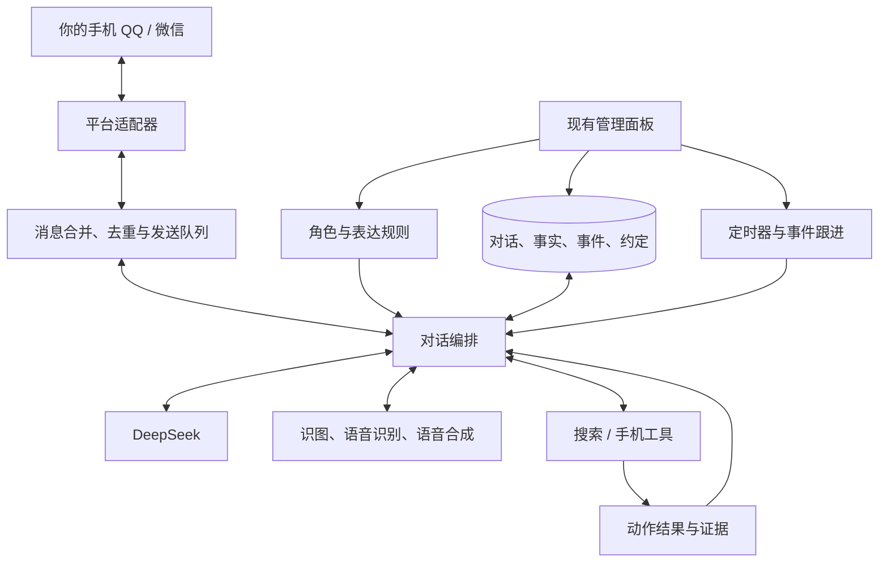

# AI 好友：视频拆解与项目方案

调研日期：2026-10-20。用户已确认微信、QQ 均可，因此优先考虑 QQ。本文是需求分析和选型建议，尚未安装机器人、登录账号或实测消息投递。

后续已确定以复用 AstrBot 为主的[技术栈选型](./技术栈选型.md)。注意：配套记忆插件当前仅声明 OneBot 平台，QQ 官方通道兼容性仍需验证，不能将下文的推荐组合视为已验证可运行。

## 1. 结论与建议

建议先以 **AstrBot + QQ 官方机器人 + DeepSeek + 陪伴/记忆插件** 做个人自用原型。先验证聊天、记忆和主动消息，再加语音。若必须使用普通 QQ 账号的好友身份，再评估 NapCat 通道。

这套方案可大量复用现有代码和管理界面。最需要自己调整的是角色设定、记忆范围、主动联系时机，以及插件与平台的兼容性。手机操作属于后续独立能力，不能把一个聊天模型直接等同于完整手机 Agent。

AstrBot 当前文档提供 QQ 官方机器人扫码创建、消息列表单聊，并列出文本、图片、语音等收发能力。平台支持某种消息，仍需对应的模型/语音服务才能生成内容。[QQ 接入文档](https://github.com/AstrBotDevs/AstrBot/wiki/zh-platform-qqofficial-websockets)

| QQ 入口 | 对外形态 | 选型顺序 |
| --- | --- | --- |
| 官方机器人 | 联系人中的机器人，可在消息列表单聊 | 优先验证，平台规则和账号权限以当前开放平台为准 |
| NapCat 普通号 | 已登录的普通 QQ 账号，更接近日常好友 | 只有普通号形态或特定 OneBot 能力确有需要时再选 |

官方 QQ 当前也支持主动推送，不沿用旧教程中“一律只能被动回复”的说法。具体配额与账号开关见腾讯[消息收发概述](https://bot.q.qq.com/wiki/develop/api-v2/server-inter/message/overview.html)。完整的项目维护、微信替代路线与许可核查见[开源项目核查](./开源项目核查.md)。

## 2. 从视频中可以确认什么

原视频约 69 秒，640×1280。已抽取全片间隔画面并放大核对关键聊天截图，截图索引位于 `../research/video_frames/contact_sheet.jpg`。视频以聊天截图为主，外层是微信群转发记录，内层聊天有 QQ 在线状态及界面特征。无法仅凭画面确认模型确实是 DeepSeek，也无法确定原作者用了哪个开源项目。

| 时间段 | 画面中的内容 | 可提炼的需求 | 证据边界 |
| --- | --- | --- | --- |
| 约 4–16 秒 | 手机工具连不上，隔天继续追问，中午问候 | 自然短句、时间感知、未完话题跟进 | 能看到跨时段聊天，不能直接证明后端长期记忆实现 |
| 约 16–24 秒 | 发饭菜图片、询问喜好、谈论上课 | 图片输入、用户生活背景、角色口吻 | 个别回复也可能只依据文字提示；识图能力需另测 |
| 约 24–32 秒 | 多条消息、表情和语音条；手机桌面截图 | 分段回复、语音、图片发送、设备状态 | 有语音条不等于实时语音通话 |
| 约 32–44 秒 | 描述 B 站首页、视频及弹幕，称自己滑动和点开视频 | 屏幕理解、手机操作、见闻分享 | 没有同步展示工具执行与屏幕变化，不能证明真操作或连续看懂整段视频 |
| 约 44–56 秒 | 询问收藏夹权限、约定早晚问候、改名等 | 行为权限、待办、主动联系、关系连续性 | 对话中的同意不等于程序已具备相应接口 |
| 约 60–68 秒 | 语音条及一条类似个人动态的卡片 | 声音表现、经历总结、可选社交动态 | 不能推断能直接自动发微信朋友圈 |

视频里的“手机打不开”“语音发不了”也是需求的一部分：系统应知道工具是否可用，失败时如实说明，稍后可以继续跟进。

## 3. 需求拆成七个模块

### 3.1 聊天入口

接收文字、引用、图片和语音；把回复送回同一会话；保留发送者和消息 ID；只处理指定用户。必须区分“QQ 官方机器人身份”和“普通 QQ 好友账号”。前者可在消息列表私聊，后者涉及接管账号。

### 3.2 角色与表达

设置名字、称呼、语气、背景、兴趣和关系。采用短句，按语义分成少量消息；合并用户短时间连发的内容，减少逐条打断。角色背景和真实执行记录分别保存。

### 3.3 记忆

分为最近对话、长期事实、共同事件、未完成约定。例如记住用户上课时间、喜欢的内容、昨天手机工具没连好。每条重要记忆保留来源与时间，可查看、更正和删除；不同用户隔离。

DeepSeek 的 Chat Completions 接口本身不替应用保管多轮上下文，需要调用方组织历史。长期记忆必须由机器人程序持久保存并按需召回。[DeepSeek 多轮对话说明](https://api-docs.deepseek.com/guides/multi_round_chat/)

### 3.4 主动联系

有两类触发：固定约定（早安、晚安），事件跟进（昨天说手机没接好，今天问结果）。程序负责唤醒和发送，模型负责判断内容与措辞。加入免打扰、每日限额、冷却与未回应降频；不要持续调用模型空转。

### 3.5 多模态

语音输入 → 转文字 → 理解 → 回复文字 → TTS 合成 → 平台语音消息。图片经过支持图片的模型理解。音频文件、可播放的原生语音条、实时通话是三个不同验收目标。先用普通音色验证链路，角色音色后置。

### 3.6 工具和设备

天气、搜索、链接阅读、截图、点击、滑动各自作为工具。涉及手机时采用“截图 → 理解 → 动作 → 再截图核对”的循环。限定设备、应用、步数和成本，用户可随时停止。工具失败不能被模型改写成成功。

### 3.7 管理与运行

复用现有 WebUI 管理人设、模型密钥、监听对象、主动开关和日志。保存记忆与任务状态，处理断网、重连和重复消息。个人原型先在本机运行；全天在线才需要长期在线主机。使用云端 DeepSeek 时无需在本机部署大模型，但对话上下文会发送给模型服务。

## 4. 推荐架构



建议先采用一个对话核心和一个本地持久化存储，不先引入复杂的多 Agent 系统。模块分开是为了以后更换 QQ/微信入口时保留人设和记忆。

如果后续需要自行扩展，采用插件项目结构即可，不必重写 AstrBot：

```text
chatbot/
├─ docs/                       需求、选型与验收记录
├─ personas/                   角色与表达配置
├─ plugins/                    自己需要补充的功能
│  └─ personal_companion/
│     ├─ conversation/         消息合并与上下文组织
│     ├─ memory/               事实、事件与约定
│     ├─ proactive/            主动联系判断
│     └─ tools/                手机与其他外部工具
├─ config/                     本地配置、密钥引用
└─ data/                       私人记忆、媒体与运行记录
```

上述是建议结构，目前没有创建业务代码。密钥和私人聊天数据不进入公共代码仓库。

## 5. 值得直接使用或学习的项目

| 项目 | 用途 | 本项目建议 |
| --- | --- | --- |
| [AstrBot](https://github.com/AstrBotDevs/AstrBot) | 多平台消息、模型配置、插件、管理界面；主仓库 AGPL-3.0 | 首选底座；先用 QQ 官方通道验证私聊与语音 |
| [private_companion](https://github.com/menglimi/astrbot_plugin_private_companion) | 角色状态、日程、主动联系、关系连续性 | 最贴近视频体验；当前 metadata 声明 aiocqhttp、qq_official，要求 AstrBot >=4.22.0；处于重构期，固定验证版本 |
| [memory_companion](https://github.com/menglimi/astrbot_plugin_memory_companion) | 与陪伴模块协作的独立记忆核心 | 需要长期记忆时选装，不把“装了陪伴”误认为自动有完整长期记忆 |
| [NapCatQQ](https://github.com/NapNeko/NapCatQQ) | NTQQ 消息协议端，通过 OneBot v11 接 AstrBot | 普通 QQ 号形态的备选；非腾讯官方机器人接口；当前仓库有非商业等许可限制，不按宽松开源代码随意复制二开 |
| [MaiBot](https://github.com/Mai-with-u/MaiBot) | 强调自然聊天、表达学习和类人交互，起点偏 QQ 群聊 | 第二套候选，适合对比聊天感觉；与 AstrBot 二选一做底座，避免维护两套状态 |
| [CowAgent，原 chatgpt-on-wechat](https://github.com/zhayujie/CowAgent) | 多平台 Agent、记忆、工具、调度 | 若更重视办事和工具执行，可作替代；无需与 AstrBot 叠加 |
| [Open-AutoGLM](https://github.com/zai-org/Open-AutoGLM) | 截图理解、ADB 手机动作循环 | 后期手机操作参考，不能代替聊天陪伴模块 |

陪伴插件的当前平台声明见 [metadata.yaml](https://github.com/menglimi/astrbot_plugin_private_companion/blob/main/metadata.yaml)，插件与记忆模块的分工见其 README。其仓库当前未检索到根目录 LICENSE，不根据主框架许可证推断插件许可；复制、分发前需另行确认。

NapCat 的限制见 [LICENSE](https://github.com/NapNeko/NapCatQQ/blob/main/LICENSE)；其源码公开不等于无限制商用、改造或公开发布修改版。普通账号接入还受账号风控、登录状态和客户端更新影响，不承诺零封禁或永久可用。[AstrBot OneBot 接入说明](https://github.com/AstrBotDevs/AstrBot/wiki/zh-platform-aiocqhttp)

### 手机与共同活动的其他参考

[reality_companion](https://github.com/menglimi/astrbot_plugin_reality_companion) 提供现实设备与 Android 网关相关能力；[together_companion](https://github.com/menglimi/astrbot_plugin_together_companion) 提供浏览器通话、共同观看与视觉上下文。它们不自动等同于“自主操控 Android 刷 B 站”。Open-AutoGLM 更直接对应手机动作，其仓库列出 B 站等应用；模型、设备与具体页面仍需验证。

## 6. 微信路线与旧教程陷阱

如果以后加微信，优先评估 [腾讯 openclaw-weixin](https://github.com/Tencent/openclaw-weixin) 对应的官方入口。AstrBot 已有 [weixin_oc 适配器文档](https://github.com/AstrBotDevs/AstrBot/wiki/zh-platform-weixin_oc)，需要支持 ClawBot 的手机微信；它是助手会话入口，不能据此推断能接管普通号的所有好友和群。

AstrBot 当前微信通道文档列语音可收、不可发，因此不能直接照搬 QQ 的语音方案。主动推送还受会话上下文时效约束，腾讯仓库 [issue #202](https://github.com/Tencent/openclaw-weixin/issues/202) 与 [#309](https://github.com/Tencent/openclaw-weixin/issues/309) 存在不同时间窗口的反馈，不把 24 小时当稳定投递承诺。

需谨慎看待的旧推荐：

- **KouriChat 当前主线**：仓库描述明确禁止接入微信、QQ 等腾讯软件，当前 LICENSE 为非商业自定义许可；适合了解演进，不选作本需求的直接接入底座。[仓库](https://github.com/KouriChat/KouriChat)、[许可文件](https://github.com/KouriChat/KouriChat/blob/main/LICENSE)
- **WeChatBot_WXAUTO 系列**：不同分支的兼容性、驱动和许可证不相同。[wechatbot-new](https://github.com/fanyuantaier/wechatbot-new) 自述支持微信 4.1.12+，但当前依赖走本地数据库读取与 OCR 发送，并非旧 wxauto UIA 路线。其旧 LICENSE_COMPLIANCE 文档与现行依赖有出入，选型以 [requirements.txt](https://github.com/fanyuantaier/wechatbot-new/blob/main/requirements.txt) 和 [wxbot.py](https://github.com/fanyuantaier/wechatbot-new/blob/main/wxbot.py) 为准；本次没有运行验证。
- **wxauto、WeChatFerry、Gewechat 老教程**：不能把历史演示当作当前微信版本可用。具体核查见配套《开源项目核查.md》。

## 7. 分阶段实施与验收

| 阶段 | 只解决的主要问题 | 完成证据 |
| --- | --- | --- |
| 0 接入验证 | QQ 官方 Bot 能否满足本人账号的单聊、语音、主动消息 | 手机上实际收到文字、原生语音及定时消息；记录账号权限和限制 |
| 1 基础 AI 好友 | 一对一、固定角色、跨重启记忆 | 连续聊天自然；重启后能引用正确的既有事实；其他会话不串记忆 |
| 2 陪伴连续性 | 主动问候与跟进昨天的事 | 用户未发新消息时能按约定触达；免打扰不发送；不重复追问 |
| 3 语音与图片 | 双向语音、图片理解 | 收到语音可理解；回复是手机可播放的语音条；不靠文本提示猜图 |
| 4 设备工具 | 授权后查看、操作备用手机 | 每个动作有截图或结果回执；失败如实报告；停止后不继续执行 |

建议的第一版范围：一个用户、一个角色、QQ 私聊、文本、少量长期事实、可关闭的早晚问候和本地管理界面。先体验一段真实连续对话，再决定是否需要生活模拟、空间动态或手机自动化。

成本主要来自模型调用、语音/视觉服务以及持续在线主机。先使用现有电脑和远程模型 API，不提前购买服务器或下载大模型；具体月费用用真实对话与主动任务的调用量估算。

## 8. 当前交付状态

- 已完成：视频画面核查、需求分层、架构建议、官方仓库与部分源码核查。
- 尚未完成：原作者技术栈鉴定、账号登录、任何候选项目部署、投递和插件兼容性实测。
- 下一步最有价值的验证：AstrBot 的 QQ 官方入口能否在用户自己的账号上实现单聊、主动消息和原生语音；满足后再配置角色和记忆。
